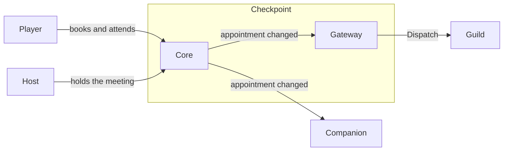
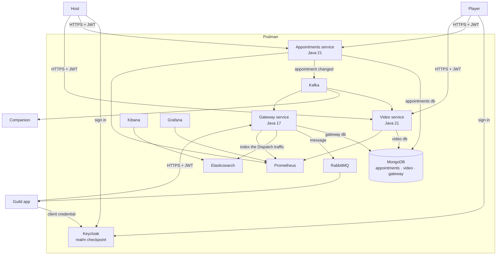
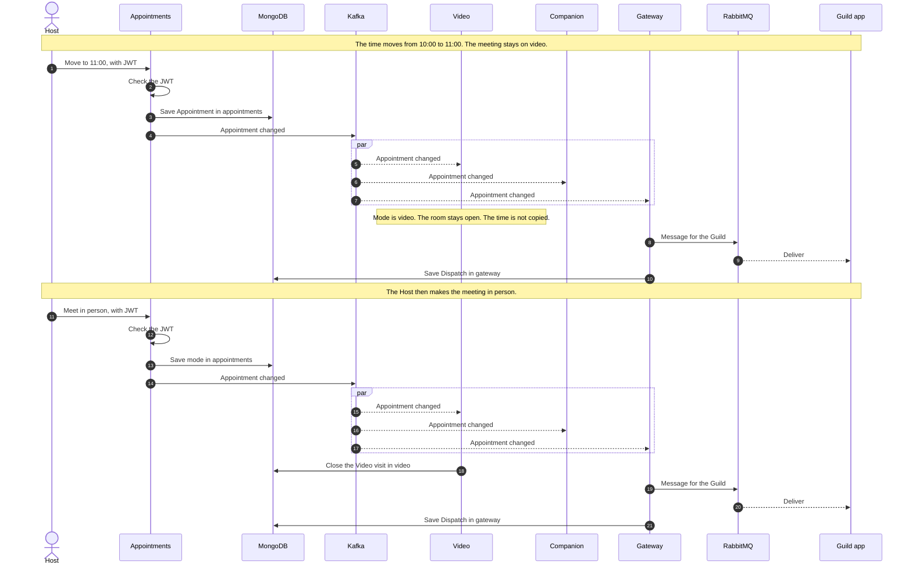

# Checkpoint

Checkpoint is a clinic system with two contexts. **Core** owns each **Appointment** and its **Video visit**. **Gateway** owns each **Guild** and each **Dispatch**. The two contexts share an appointment identifier. They do not share data, and Gateway never changes an Appointment.

A **Player** is the person an Appointment is for. A **Host** is the clinician who holds it. A **Companion** is another app in the Checkpoint family. A Guild is an organization outside Checkpoint.

The words live in [the glossary map](../GLOSSARY-MAP.md). This document is how the running system carries them.

## Context

Player and Host talk to Core. Core is the only context that changes an Appointment, including its time and whether the meeting is by video or in person.

When an Appointment changes, Core announces that fact. Two listeners hear the same announcement. Companion updates its own view and does not write back. Gateway records a Dispatch for a Guild and sends that Guild the news. The Dispatch is the record of the sending. It is not a second Appointment.

## Containers

Everything below runs in Podman. Kubernetes is a later deployment of these same containers, drawn only after this Podman system already runs.

### Core

Two services, one MongoDB server, two databases.

The appointments service runs on Java 21 and is the only writer of an Appointment. Its database is `appointments`. An Appointment stores the Player, the Host, the time, and the mode: video or in person.

The video service runs on Java 21. Its database is `video`. A Video visit is the live room for an Appointment whose mode is video, stored under that appointment's identifier. The time, the Player, and the Host stay on the Appointment. The video service does not read the `appointments` database. It learns changes from the announcement.

Player and Host reach both Core APIs over HTTPS with a JWT. Opening the room is a call to the video service. The room is found by the appointment identifier.

### The announcement

The appointments service saves the Appointment first, then publishes on Kafka. The meeting is kept even when Kafka is down. The service retries the announcement until the listeners can hear it.

The announcement carries the appointment identifier, the time, and the mode. Listeners do not call back into Core to discover those facts, and they do not write the Appointment.

Three listeners receive it:

- The video service. While the mode is video, the room stays open and the new time is not copied. When the mode is in person, the service closes the room in the `video` database.
- Companion, the stand-in app for the rest of the family. It keeps its own view of the meeting.
- The gateway service.

A repeated announcement with the same identifier, time, and mode is the same news. Each listener can apply it twice and end in the same place.

### Gateway

The gateway service runs on Java 17, so the study keeps both Java releases. Its database is `gateway`. It never opens the `appointments` or `video` databases.

On an announcement, Gateway hands a message to RabbitMQ for the Guild app, then stores a Dispatch in `gateway`. The Dispatch records the appointment identifier, the time, and the mode that were passed to that Guild. If the process stops after the send and before the save, a retry may send the same news again. The Guild app treats that repeat as the same news.

The Guild app is the second stand-in. It only receives. Companion never uses RabbitMQ, and the Guild app never consumes Kafka. The two paths stay separate: family apps hear the announcement, a Guild hears a message.

A Guild can also call the gateway over HTTPS. Keycloak issues that token. This study's flow is the outbound message; the token is what the gateway checks when a Guild calls in.

Gateway writes the same Dispatch facts to Elasticsearch so the traffic can be searched. Kibana reads Elasticsearch. MongoDB remains the record. A failed index does not remove the Dispatch.

### Sign-in

One Keycloak realm, `checkpoint`, issues every token.

Player and Host have accounts and sign in as people. A Guild has a client of its own and authenticates with a client credential. The three services check the JWT: signature, issuer, and expiry. Core accepts a Player or a Host. Gateway accepts the Guild client on calls from a Guild.

HTTPS ends at Keycloak and at the three APIs. The study does not encrypt individual fields.

### Whether it is up, and what was sent

Each service writes structured logs that include the appointment identifier.

Each service exposes metrics. Prometheus scrapes all three. Grafana reads Prometheus and shows whether the services are up.

Kibana is for the Dispatch traffic, not for "is the process up."

## A meeting moves from 10:00 to 11:00, then becomes in person

The Host already holds a JWT from Keycloak. The Appointment exists, its mode is video, and the video service already has a room for it.

First change. The appointments service checks the Host's JWT and saves 11:00 in `appointments`. That save is the change. Kafka then carries the identifier, the new time, and the mode `video`. The video service sees that the meeting is still by video, so the room stays open and the 11:00 is not written into `video`. Companion updates its own view to 11:00. Gateway sends the Guild a message and stores a Dispatch. Core's Appointment is untouched by all three listeners.

Second change. The Host sets the mode to in person. The same save-then-announce path runs. The video service closes the room. Companion updates its view. Gateway stores a second Dispatch and sends a second message. The first Dispatch remains: it is the record of the earlier sending, not a copy of the meeting.

## Toolchain

The git remote is GitHub and the repository is public. GitHub Actions uses standard hosted runners, which are free for a public repository, and the account has no payment method.

SonarQube Community Build runs in Podman beside the other containers. It analyzes the main branch. It is not on the path from a Host to a Guild.

Left out of this picture, on purpose: APM, HDS, field-level encryption, Jenkins, and GitLab CI. Kubernetes waits until the Podman system already runs.
